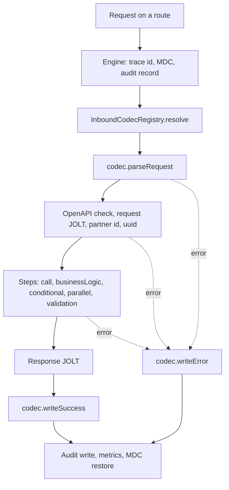

# RouteForge release notes

## Unreleased: inbound codec (SOAP support, part 1 of 4)

The engine's JSON request parsing and response writing now sit behind a pluggable **inbound codec**. JSON routes behave exactly as before; the change opens a seam where the SOAP channel will plug in without touching the step pipeline.

**Behaviour change for existing routes: none.** Bima Sugam and every other JSON route keep the same request handling, response envelope, status codes, encryption and audit.

### Upgrade notes for PIE

| Check | Action |
| --- | --- |
| Route JSON files | No change |
| `application.properties` | No change; no new properties |
| Component scan | New beans live in `com.rsa.routeforge.inbound` (`JsonCodec`, `InboundCodecRegistry`). Scanning `com.rsa.routeforge` covers them. If PIE lists RouteForge packages one by one, add `com.rsa.routeforge.inbound`, otherwise the engine bean fails to start with a missing `InboundCodecRegistry` |
| Code that calls `new OrchestrationEngine(...)` | Still compiles: the previous 16-argument constructor is kept and uses JSON for every route |
| Code that subclasses or calls the engine's private parsing or writing | Not supported before or after; `parseIncoming` and `writeResponse` are now in `JsonCodec` |

### Added

- `InboundCodec`: interface for a route's wire format, with `supports`, `parseRequest`, `writeSuccess` and `writeError`.
- `JsonCodec`: today's JSON behaviour, moved verbatim from the engine. Supports every route and is ordered last, so it stays the default.
- `InboundCodecRegistry`: picks the codec for a route.
- `EngineHeaders`: the `X-Correlation-Id` and `X-Engine-Status` header names.
- GitHub Actions build (`.github/workflows/build.yml`): `mvn verify` on JDK 25 for every push and pull request.
- Tests: `JsonInboundBehaviourTest` (9), `InboundCodecRegistryTest` (4), `InboundCodecRoutingTest` (3).

### Changed

- `OrchestrationEngine.execute` resolves a codec per request and delegates parsing and writing to it. The private `parseIncoming` and `writeResponse` methods are removed from the engine.
- `OrchestrationEngine` has a new `@Autowired` constructor that takes an `InboundCodecRegistry`.

### Unchanged

Step types (`call`, `businessLogic`, `conditional`, `parallel`, `validation`) and their config, the `ctx` map, route loading and validation, `RoutesBuilder`, paths, the response envelope, `engine.http.*` status rules, payload encryption, OpenAPI validation, audit and metrics.

---

## Technical documentation

### Request lifecycle



The engine owns everything between parsing and writing; a codec only works at the two edges. The raw body is still read once by the engine, before the codec runs, so a request that fails to parse is still on its audit row.

### The `InboundCodec` contract

| Method | Called | Must |
| --- | --- | --- |
| `supports(cfg)` | Once per request, during codec selection | Decide from the route config alone; a thrown exception counts as "no" |
| `parseRequest(cfg, exchange, rawBody)` | Inside the engine's error boundary | Return the input map (becomes `ctx.rawInput`, then `ctx.input` after request JOLT); throw `OrchestrationException` for a bad request |
| `writeSuccess(exchange, cfg, body, uuid, traceId, audit)` | After the steps and response JOLT | Set the response body and headers; fill the audit record's response body and statuses |
| `writeError(exchange, cfg, error, traceId, failedStep, uuid, audit)` | From the error boundary | Same as `writeSuccess` for a failure; should not throw, because anything thrown escapes to the route's Camel safety net |

### Codec selection

`InboundCodecRegistry` receives every `InboundCodec` bean in `@Order` order and, for each request:

1. Returns the first codec whose `supports(cfg)` is true.
2. Skips a codec whose `supports` throws.
3. If none claims the route, returns the last codec (`JsonCodec`, ordered `LOWEST_PRECEDENCE`).

It never throws, because the engine needs a codec even to write an error.

### `JsonCodec` reference

This is the behaviour pinned by `JsonInboundBehaviourTest`. It is what every route did before this release.

**Request**

- An empty or blank body is allowed; input then comes from headers only.
- A non-empty body must be a JSON object. Malformed JSON or a non-object (for example an array) gives `INVALID_REQUEST` with the message `"INVALID  REQUEST"` (two spaces), logical status 400.
- With an `encryptionProfile`, the body must be `{"encrypted_data": ..., "key_id": ...}`. A missing field, a failed decryption or decrypted text that is not a JSON object gives `INVALID_REQUEST` / `"INVALID ENCRYPTED REQUEST"`, logical status 400.
- Request headers are merged into the input, except `Accept`, `Accept-Encoding`, `Accept-Language`, `Connection`, `Content-Type`, `Content-Length`, `Host`, `User-Agent`, `Postman-Token`, `Cache-Control`, `X-Correlation-Id`, `Authorization`, `breadcrumbId` and the `CamelHttp*` names listed in the code. A body field wins over a header with the same name.

**Response**

- Success envelope, in this field order: `uuid`, `status_code` (`"200"`), `error` (`code` and `message` both `""`), `data`.
- Error envelope: `uuid`, `status_code` (logical status as a string), `error` (`code`, `message`, `traceId`, `step`, `details`), `data` (`null`).
- `uuid` is the audit id. It is `null` when the request fails before the uuid is resolved, for example on malformed JSON.
- Without a `responseJoltSpec`, `data` is the whole context (`rawInput`, `input`, `partnerCode`, `partnerId` when a partner is configured, `uuid` and every step result).
- With an `encryptionProfile`, the whole envelope is encrypted and sent as `{"encrypted_data": ..., "key_id": ...}`; the audit keeps the plaintext envelope.
- Headers: `Content-Type: application/json`, `Accept: application/json`, `X-Engine-Status` (logical status), `X-Correlation-Id` (trace id), and the HTTP status.

**HTTP status on the wire**

| `engine.http.propagate-status` | Route matches `engine.http.always-200-routes` (default `bimasugam-*`) | Wire status |
| --- | --- | --- |
| `false` (default) | Any | 200 |
| `true` | Yes | 200 |
| `true` | No | Logical status |

The logical status is always in `X-Engine-Status`, the envelope's `status_code` and the audit record.

### Adding a codec

A codec is a Spring bean that implements `InboundCodec`, ordered ahead of `JsonCodec` and claiming only its own routes:

```java
@Component
@Order(100)
public class SoapCodec implements InboundCodec {

    @Override
    public boolean supports(TransactionConfig cfg) {
        return "soap".equals(cfg.channel());   // channel arrives in part 3
    }

    @Override
    public Map<String, Object> parseRequest(TransactionConfig cfg, Exchange exchange, String rawBody) {
        // parse the envelope, dispatch on the body element, return the configured fields
    }

    @Override
    public void writeSuccess(Exchange exchange, TransactionConfig cfg, Object body, String uuid,
                             String traceId, RouteAuditRecord audit) {
        // write the operation's response wrapper and fill the audit record
    }

    @Override
    public void writeError(Exchange exchange, TransactionConfig cfg, OrchestrationException error,
                           String traceId, String failedStep, String uuid, RouteAuditRecord audit) {
        // write a SOAP fault or the partner's error response; never throw
    }
}
```

### Testing

| Test | What it covers |
| --- | --- |
| `JsonInboundBehaviourTest` | Plain JSON success; generated uuid; empty body; malformed JSON; array body; status propagation and always-200 routes; encrypted success; encrypted request without `key_id`; encrypted payload that is not JSON. Committed and green before the refactor, unchanged after it. |
| `InboundCodecRegistryTest` | First match wins, fallback to the last codec, a throwing `supports`, at least one codec required. |
| `InboundCodecRoutingTest` | A non-JSON codec parses and writes its own route on success and failure; other routes still use JSON. |

Run locally with `mvn verify` (JDK 25).

### What comes next

| Part | Scope |
| --- | --- |
| 2 | Hardened XML reader (no DTDs or external entities, size, depth and element limits) and the SOAP 1.1 response and fault writer, tested against the Maruti and MIBL samples |
| 3 | `channel` and `soap` on route files, SOAP routes grouped by path and dispatched by body element, `?wsdl` serving, `CredentialVerifier` |
| 4 | XML masking of credentials in audit, SOAP fault metrics |

SOAP stays off by default (`routeforge.soap.enabled=false`) until PIE opts in.
