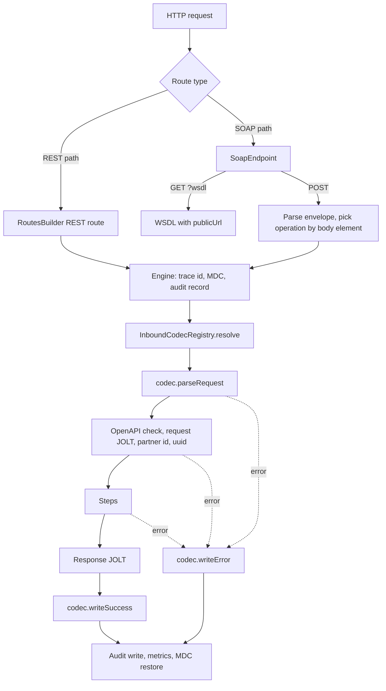

# RouteForge release notes

## Unreleased: SOAP channel

RouteForge can now expose **SOAP 1.1 APIs** next to its JSON APIs. A SOAP API is a route file like any other, with `"channel": "soap"` and a `soap` block; route files that share a path form one SOAP service. The work landed in four parts:

| Part | What it adds |
| --- | --- |
| 1. Inbound codec | Request parsing and response writing moved out of the engine behind `InboundCodec`; JSON behaviour unchanged |
| 2. XML core | Hardened XML reader and a SOAP 1.1 response and fault writer |
| 3. SOAP channel | `channel` and `soap` on route files, dispatch by body element, `?wsdl`, partner login check |
| 4. Audit and metrics | Credentials masked in XML audit payloads; SOAP fault counter |

**Behaviour change for existing JSON routes: none.** Bima Sugam and every other JSON route keep the same request handling, response envelope, status codes, encryption and audit (one audit edge case, an XML body sent to a JSON route, is listed under Changed). SOAP is **off by default** (`routeforge.soap.enabled=false`).

### Upgrade notes for PIE

| Check | Action |
| --- | --- |
| Route JSON files | No change. `channel` defaults to `rest` |
| `application.properties` | No change needed. New optional `routeforge.soap.*` properties (below) |
| Component scan | New beans in `com.rsa.routeforge.inbound` (`JsonCodec`, `InboundCodecRegistry`) and `com.rsa.routeforge.soap` (`SoapCodec`). Scanning `com.rsa.routeforge` covers them. If PIE lists RouteForge packages one by one, add both, otherwise the engine bean fails to start with a missing `InboundCodecRegistry` |
| `new OrchestrationEngine(...)` in PIE code | Still compiles: the previous 16-argument constructor is kept and uses JSON for every route |
| `new TransactionConfig(...)` in PIE code | Still compiles: the previous 10-argument constructor is kept and builds a REST route |
| Admin reload (`/admin/routes/reload/{id}`) | Unchanged for REST routes; refuses SOAP operations (restart instead) |

### Onboarding a SOAP partner in PIE

1. Add the partner's WSDL under resources, for example `partners/mibl/MiblWebSystem.wsdl`.
2. Add one route file per operation (sample below), all with the same `path`.
3. If any operation uses `bodyCredentials`, provide a `CredentialVerifier` bean.
4. Set `routeforge.soap.enabled=true`.
5. Point APIM or the load balancer at `<path>`; partners fetch the WSDL from `<public URL>?wsdl`.

### Added

- **Part 1:** `InboundCodec`, `JsonCodec` (today's JSON behaviour, moved verbatim), `InboundCodecRegistry`, `EngineHeaders`; GitHub Actions build (`mvn verify` on JDK 25).
- **Part 2:** `SafeXmlReader`, `SoapRequest`, `SoapResponseWriter`, `SoapLimits`, `QNames`; config records `SoapRouteConfig`, `SoapAuthConfig`, `SoapResponseConfig`; the `CredentialVerifier` interface.
- **Part 3:** `SoapCodec`, `SoapService`, `SoapEndpoint`, `SoapExchange`; `channel` and `soap` on `TransactionConfig`; `routeforge.soap.*` properties.
- **Part 4:** XML masking in `AuditPayloadSanitizer`; `engine.soap.faults` counter.
- Error codes: `SOAP_MALFORMED`, `SOAP_VERSION_MISMATCH`, `SOAP_REQUEST_TOO_LARGE`, `SOAP_UNKNOWN_OPERATION`, `SOAP_UNSUPPORTED_MEDIA_TYPE`, `AUTHENTICATION_FAILED`.

### Changed

- `OrchestrationEngine.execute` resolves a codec per request and delegates parsing and writing to it; a new `@Autowired` constructor takes an `InboundCodecRegistry`.
- `RouteConfigLoader` lets SOAP operations share a path (REST duplicate-path handling is unchanged) and reports SOAP routes as a problem while SOAP is disabled.
- `RouteConfigValidator` checks `channel` and the `soap` block. REST files are checked only for a stray `soap` block.
- `RoutesBuilder` builds one Camel route per SOAP path; REST routes are defined exactly as before.
- `AuditPayloadSanitizer`: an XML payload is now always masked (elements named `password`, plus `engine.audit.mask-fields`). Before, an XML payload was stored as is, or withheld entirely when `mask-fields` was set. JSON payloads are handled exactly as before.

### Unchanged

Step types (`call`, `businessLogic`, `conditional`, `parallel`, `validation`) and their config, the `ctx` map, JSON request handling, the JSON response envelope, `engine.http.*` status rules, payload encryption, OpenAPI validation, existing metrics.

### Known limitations

- SOAP 1.1 only; a SOAP 1.2 envelope gets a `VersionMismatch` fault. No WS-Security, MTOM or attachments (none of the current partners use them).
- Business errors (validation, downstream failures) are returned as SOAP faults for now. Partner-specific error codes inside the return string come with the error map and response builder.
- The data string (`~` for Maruti, `~~` for MIBL) reaches the steps as text in `ctx.input`; decoding it is the data dictionary handler's job.
- A SOAP operation cannot be reloaded on its own through the admin endpoint.

---

## Technical documentation

### Request lifecycle



The engine owns everything between parsing and writing; a codec only works at the two edges. The raw body is read once by the engine before the codec runs, so a request that fails to parse is still on its audit row.

### The `InboundCodec` contract

| Method | Called | Must |
| --- | --- | --- |
| `supports(cfg)` | Once per request, during codec selection | Decide from the route config alone; a thrown exception counts as "no" |
| `parseRequest(cfg, exchange, rawBody)` | Inside the engine's error boundary | Return the input map (becomes `ctx.rawInput`, then `ctx.input` after request JOLT); throw `OrchestrationException` for a bad request |
| `writeSuccess(exchange, cfg, body, uuid, traceId, audit)` | After the steps and response JOLT | Set the response body and headers; fill the audit record's response body and statuses |
| `writeError(exchange, cfg, error, traceId, failedStep, uuid, audit)` | From the error boundary | Same as `writeSuccess` for a failure; should not throw |

`InboundCodecRegistry` returns the first codec, in `@Order` order, whose `supports` is true (`SoapCodec` is order 100 and claims `channel: soap`), and falls back to the last one (`JsonCodec`). It never throws.

### SOAP route file reference

```json
{
  "routeId": "mibl-proposal",
  "path": "/ws/mibl/MiblWebSystem",
  "partnerCode": "MIBL",
  "channel": "soap",
  "soap": {
    "operation": "web:MIBLProposalInfo",
    "namespaces": { "web": "http://WebService.vam.com/" },
    "fields": {
      "data": "miblProposalData",
      "userName": "soapHeader/userName",
      "password": "soapHeader/password"
    },
    "auth": { "type": "bodyCredentials", "user": "userName", "password": "password" },
    "response": {
      "element": "web:MIBLProposalInfoResponse",
      "returnElement": "return",
      "returnQualified": false,
      "prefixStyle": "defaultNamespace",
      "returnEncoding": "text"
    },
    "wsdl": "classpath:partners/mibl/MiblWebSystem.wsdl",
    "publicUrl": "${pie.public-url}/ws/mibl/MiblWebSystem"
  },
  "steps": [ ... ]
}
```

| Field | Meaning | Default |
| --- | --- | --- |
| `channel` | `rest` or `soap` | `rest` |
| `soap.operation` | Qualified name of the body element that selects this operation | Required |
| `soap.namespaces` | Prefix to URI. Prefixes are config-only; partners may use any prefixes on the wire | None |
| `soap.lenientNamespaces` | Match fields (and, as a fallback, the operation) by local name only | `false` |
| `soap.fields` | Name in `ctx.input` to a path under the operation element. Steps are separated by `/`; an unprefixed step means "no namespace". One match gives its value, several give a list, none gives `null`. An element with children gives a map | At least one |
| `soap.auth.type` | `bodyCredentials`, `gateway` or `none` | `none` |
| `soap.auth.user`, `soap.auth.password` | For `bodyCredentials`: the `fields` entries holding the login | Required for `bodyCredentials` |
| `soap.auth.header` | For `gateway`: a header that must be present | None |
| `soap.response.element` | Qualified name of the response wrapper | Required |
| `soap.response.returnElement` | Local name of the single child carrying the value | Required |
| `soap.response.returnQualified` | Return element in the wrapper's namespace (Maruti) or none (MIBL, written with `xmlns=""`) | `true` |
| `soap.response.prefixStyle` | `defaultNamespace` (Axis style) or `prefixed` (`ns1:`) | `defaultNamespace` |
| `soap.response.returnEncoding` | `text` (escaped) or `cdata` (Maruti) | `text` |
| `soap.response.returnType` | `string` or `int`, informational | `string` |
| `soap.wsdl` | Resource served at `<path>?wsdl`. Placeholders allowed | None (then `?wsdl` is 404) |
| `soap.publicUrl` | Written into the served WSDL's `soap:address`. Placeholders allowed | WSDL served unchanged |

Rules checked at startup: SOAP routes are POST only and cannot use `encryptionProfile` or `openApiValidation`; every prefix must be declared; `bodyCredentials` must name configured fields; routes on one path must share `partnerCode`, `wsdl` and `publicUrl`, and each operation element may appear once; a REST route and a SOAP service cannot share a path.

### Properties

| Property | Default | Meaning |
| --- | --- | --- |
| `routeforge.soap.enabled` | `false` | SOAP route files are loaded only when true |
| `routeforge.soap.max-body-bytes` | `1048576` | Largest request accepted, in UTF-8 bytes |
| `routeforge.soap.max-depth` | `32` | Deepest element nesting, counting the Envelope as 1 |
| `routeforge.soap.max-elements` | `10000` | Most elements in one request |

### SOAP request handling

1. `SoapEndpoint` answers `GET <path>?wsdl` itself. Anything else has its `CamelHttp*` headers removed and is dispatched.
2. Dispatch checks: `POST` only; `Content-Type` containing `xml` (`text/xml` or `application/soap+xml`) when present; then parses.
3. Parsing (`SafeXmlReader`): DTDs off and any `DOCTYPE` rejected (blocks XXE and entity expansion), external entities off, size, depth and element limits. The envelope must be SOAP 1.1 with exactly one element in `Body`. The SOAP `Header` is ignored.
4. The body element's namespace and name select the operation (exact match, then lenient operations by local name).
5. A request no operation can take still runs through the engine under the service's own config (route id `soap:<path>`), so it is answered with a fault and audited.
6. `SoapCodec` reads `soap.fields` into `ctx.input` and authenticates before any step runs. With `bodyCredentials`, the password field is removed from `ctx.input` once checked, so it never reaches a step, downstream call, response or log.

### SOAP responses

- **Success:** HTTP 200, `Content-Type: text/xml; charset=utf-8`, the configured wrapper. The return value is `soapReturn` from the response body: the context, or the output of the route's response JOLT. A plain string or number body is used as is. Without `soapReturn` the return element is empty; the context itself is never sent to a SOAP partner.
- **Failure:** HTTP 500 (SOAP 1.1) with a fault. `X-Engine-Status` carries the logical status.

| Engine error | Fault code | Fault string |
| --- | --- | --- |
| `SOAP_VERSION_MISMATCH` | `VersionMismatch` | Only SOAP 1.1 is supported. |
| Any status below 500 (malformed XML, unknown operation, authentication, validation) | `Client` | The error's client-safe message |
| 500 and above (configuration, downstream, unexpected) | `Server` | The error's client-safe message, for example "An unexpected error occurred." |

The fault `detail` carries only the error code and trace id: no host name, stack trace or request content.

Sample success responses, exactly as written:

```xml
<!-- MIBL: unqualified return -->
<MIBLProposalInfoResponse xmlns="http://WebService.vam.com/"><return xmlns="">...</return></MIBLProposalInfoResponse>

<!-- Maruti: qualified return in CDATA -->
<MarutiProposalInfoNewResponse xmlns="http://proposal.maruti.royalsundaram.com"><MarutiProposalInfoNewReturn><![CDATA[...]]></MarutiProposalInfoNewReturn></MarutiProposalInfoNewResponse>
```

### Partner authentication

`CredentialVerifier` is implemented in PIE:

```java
@Component
public class PartnerCredentialVerifier implements CredentialVerifier {
    @Override
    public boolean verify(String partnerCode, String userName, String password) {
        // look up the partner's credentials and compare in constant time,
        // e.g. MessageDigest.isEqual(expectedBytes, passwordBytes); never log the password
    }
}
```

A wrong login is a `Client` fault with `AUTHENTICATION_FAILED`; a missing verifier or one that throws is a `Server` fault. For partners authenticated by APIM, use `gateway` (optionally requiring a header) or `none`.

### Audit, logging and metrics

- The raw XML request and response are stored on the existing audit rows. Elements named `password` (any prefix, any case) and any `engine.audit.mask-fields` are masked as `***`, even in malformed XML.
- `SoapCodec` logs the operation and the number of fields, never their values.
- `engine.soap.faults` counts faults by `route`, `fault` (`Client`, `Server`, `VersionMismatch`) and `code`. Existing route and step metrics apply to SOAP routes as well.

### `JsonCodec` reference

This is the behaviour pinned by `JsonInboundBehaviourTest`, unchanged from before this release.

**Request**

- An empty or blank body is allowed; input then comes from headers only.
- A non-empty body must be a JSON object. Malformed JSON or a non-object gives `INVALID_REQUEST` with the message `"INVALID  REQUEST"` (two spaces), logical status 400.
- With an `encryptionProfile`, the body must be `{"encrypted_data": ..., "key_id": ...}`. A missing field, failed decryption or decrypted text that is not a JSON object gives `INVALID_REQUEST` / `"INVALID ENCRYPTED REQUEST"`, logical status 400.
- Request headers are merged into the input, except `Accept`, `Accept-Encoding`, `Accept-Language`, `Connection`, `Content-Type`, `Content-Length`, `Host`, `User-Agent`, `Postman-Token`, `Cache-Control`, `X-Correlation-Id`, `Authorization`, `breadcrumbId` and the `CamelHttp*` names listed in the code. A body field wins over a header with the same name.

**Response**

- Success envelope, in this field order: `uuid`, `status_code` (`"200"`), `error` (`code` and `message` both `""`), `data`.
- Error envelope: `uuid`, `status_code`, `error` (`code`, `message`, `traceId`, `step`, `details`), `data` (`null`).
- `uuid` is the audit id; `null` when the request fails before the uuid is resolved.
- Without a `responseJoltSpec`, `data` is the whole context.
- With an `encryptionProfile`, the whole envelope is encrypted as `{"encrypted_data": ..., "key_id": ...}`; the audit keeps the plaintext.

| `engine.http.propagate-status` | Route matches `engine.http.always-200-routes` (default `bimasugam-*`) | Wire status |
| --- | --- | --- |
| `false` (default) | Any | 200 |
| `true` | Yes | 200 |
| `true` | No | Logical status |

### Tests

| Test | What it covers |
| --- | --- |
| `JsonInboundBehaviourTest` | JSON behaviour before and after the refactor: body and header merge, envelopes, status rules, encryption, audit. Committed and green before part 1, unchanged since |
| `InboundCodecRegistryTest`, `InboundCodecRoutingTest` | Codec selection; a non-JSON codec end to end; other routes stay JSON |
| `SoapRequestTest` | Maruti and MIBL envelopes, namespaces strict and lenient, wire prefixes, repeated elements, nil, envelope rules, XXE, entity expansion, DOCTYPE, size, depth and element limits |
| `SoapResponseWriterTest` | Exact Maruti and MIBL response bytes, `ns1` style, escaping, CDATA splitting, faults |
| `SoapCodecEngineTest` | Through the engine: success for both partners, password never reaches a step, wrong login, missing or failing verifier, gateway header, malformed XML, no context leak |
| `SoapEndpointTest` | Dispatch by body element across two operations, unknown operation, content types, GET without `?wsdl`, WSDL serving and address rewrite, 404 |
| `SoapRouteConfigTest` | Parsing old and new route files, validation errors, loading and grouping by path, REST duplicate paths still rejected, SOAP disabled |
| `AuditPayloadSanitizerXmlTest` | Password masking with and without prefixes, configured fields, malformed XML, CDATA; JSON behaviour unchanged |

Test envelopes have the same shape as the Maruti MI1.0 and MIBL UAT samples but synthetic data. Run with `mvn verify` (JDK 25).
